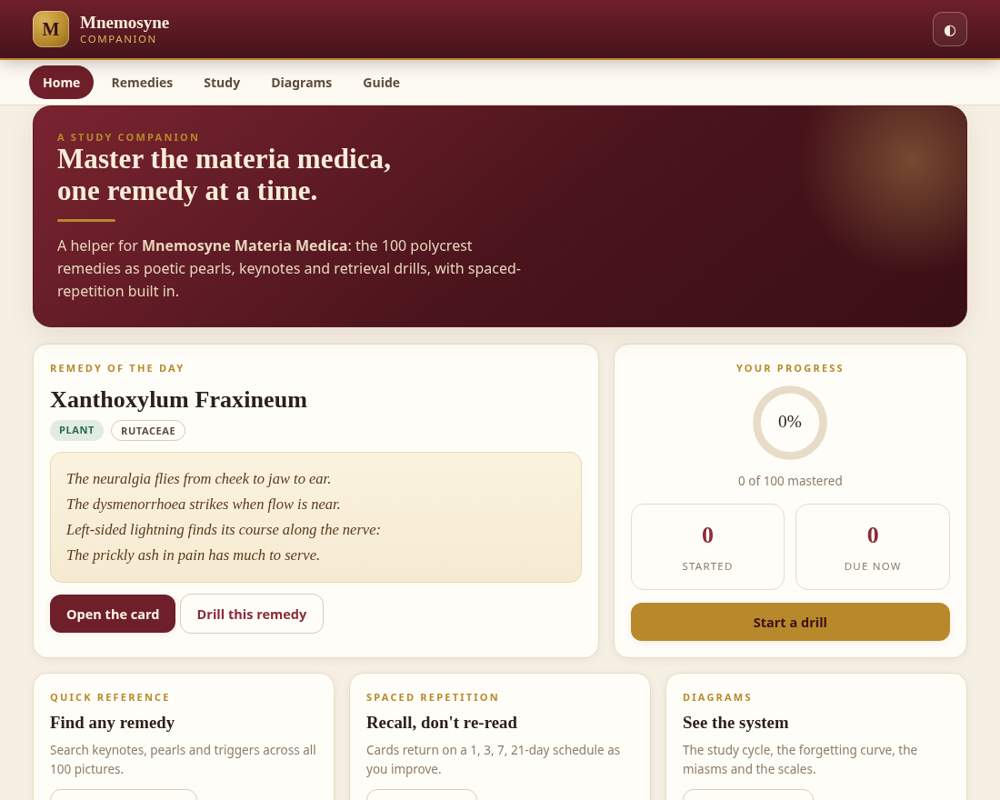
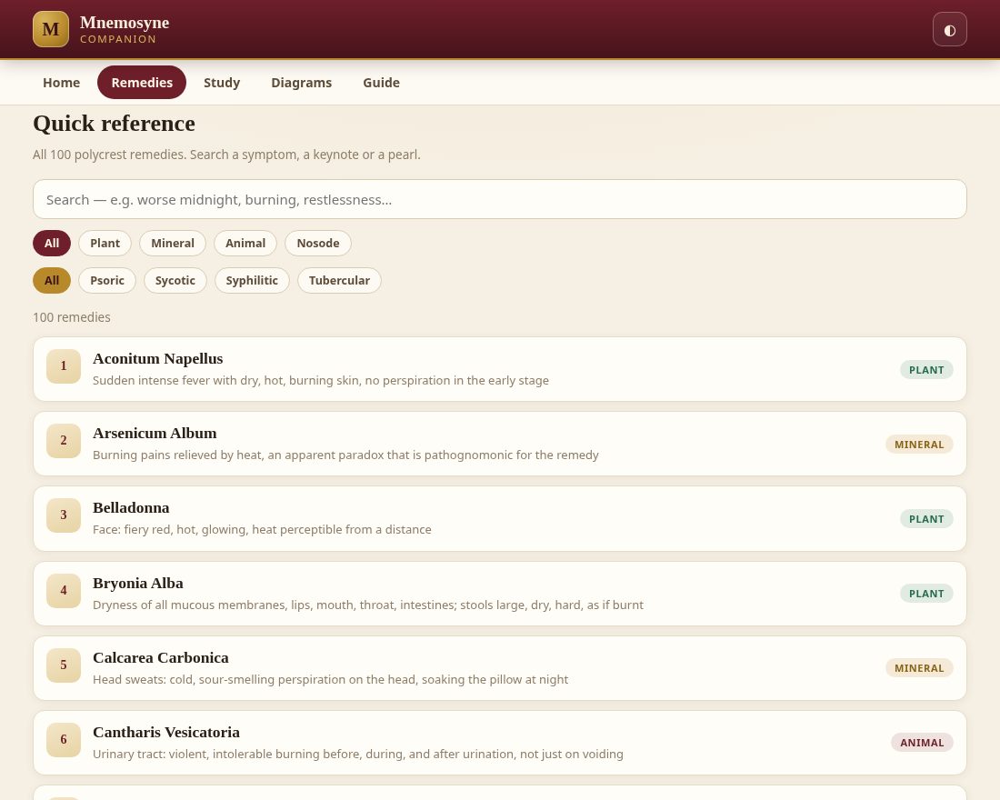
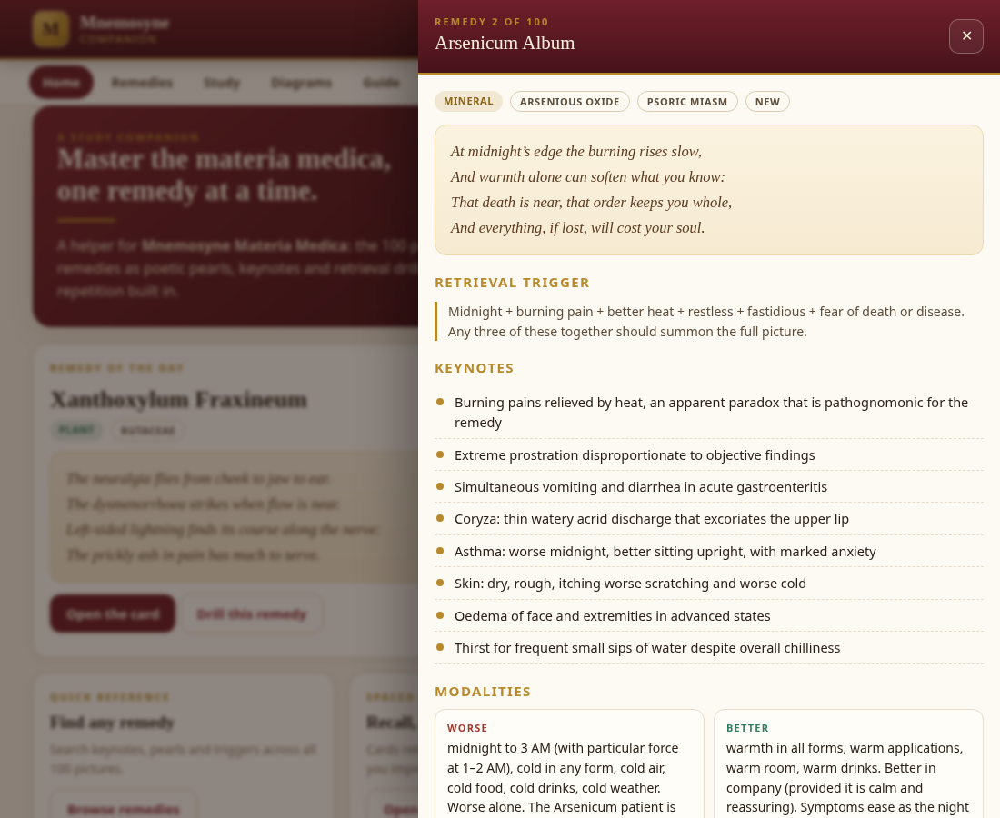
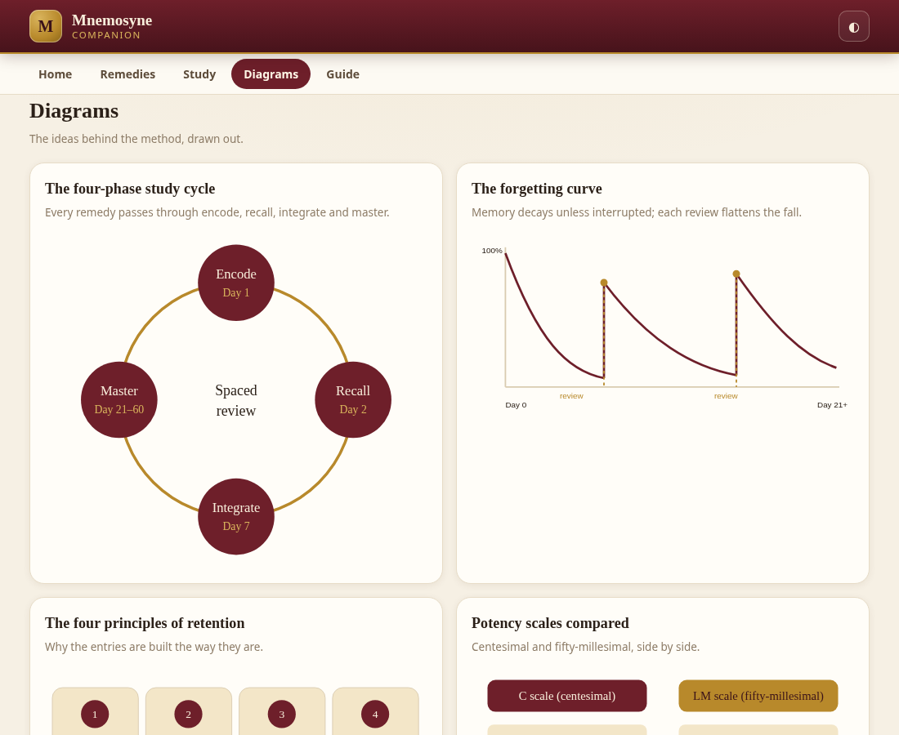
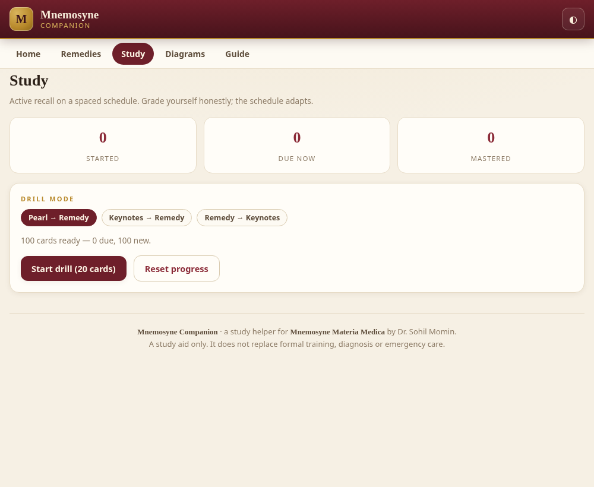
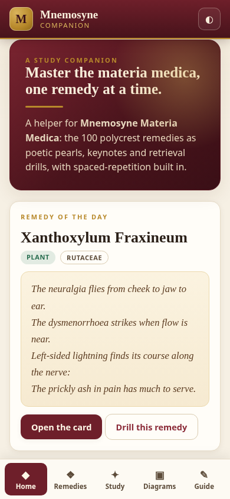

<div align="center">


# Mnemosyne Companion

**A study companion for _Mnemosyne Materia Medica_** — the 100 polycrest homoeopathic remedies as poetic pearls, keynotes and spaced-repetition drills, in a single offline app.

[](https://drsamonline.github.io/mnemosyne-companion/)
[](https://drsamonline.github.io/mnemosyne-companion/play/)
[](https://drsamonline.github.io/mnemosyne-companion/)
[](CHANGELOG.md)
[](#-what-it-contains)
[](#-what-it-contains)
[](#-features)
[](#-built-with)
[](#-works-offline)
[](docs/DISCLAIMER.md)

<br>

[**Landing page**](https://drsamonline.github.io/mnemosyne-companion/) &nbsp;·&nbsp;
[**Open the live app**](https://drsamonline.github.io/mnemosyne-companion/play/) &nbsp;·&nbsp;
[Download the app](dist/Mnemosyne_Companion.html) &nbsp;·&nbsp;
[Read the docs](docs/) &nbsp;·&nbsp;
[Report an issue](https://github.com/drsamonline/mnemosyne-companion/issues)

</div>

---

## What it is

**Mnemosyne Companion** is the companion application to the book **_Mnemosyne Materia Medica: A Memory-Optimised Clinical Guide to 100 Polycrest Homoeopathic Remedies_** by **Dr. Sohil Momin**.

The book teaches the method; this app is the practice bench. It carries the study material of all one hundred remedies — their poetic pearls, keynotes, modalities, differentials and miasmatic groupings — and turns them into an active-recall drill with a spaced-repetition schedule. It is deliberately **not** the full book: the clinical descriptions and case histories stay in the text. This is the helper you keep open while you study.

> The remedy that surfaces in three seconds is worth ten times the remedy that emerges after twenty minutes.

## Screenshots

| Home | Quick reference |
|:---:|:---:|
|  |  |

| Remedy card | Diagrams |
|:---:|:---:|
|  |  |

| Study drill | On a phone |
|:---:|:---:|
|  |  |

## What it contains

- **All 100 remedies** — number, name, family, kingdom (plant / mineral / animal / nosode), and miasmatic group where the book classifies one.
- **Eight keynotes per remedy** — the strange, rare and peculiar symptoms that name the picture.
- **The Poetic Pearl** for every remedy — the four-line verse that fixes its emotional essence.
- **A retrieval trigger** — the few words meant to summon the whole picture.
- **Modalities** — the better and worse that seal the choice.
- **Differentials** — how each remedy separates from its nearest competitors.

## Features

| | |
|---|---|
| 🔎 **Quick reference** | Search all 100 pictures by symptom, keynote or pearl; filter by kingdom and by miasm. |
| 🃏 **Spaced repetition** | Flashcards in three modes — Pearl → Remedy, Keynotes → Remedy, Remedy → Keynotes — graded Again / Hard / Good / Easy on a 1, 3, 7, 21, 45-day schedule. |
| 📈 **Progress** | Started, due-now and mastered counts, with a progress ring. Saved locally in your browser. |
| 🖼️ **Six SVG diagrams** | The four-phase study cycle, the forgetting curve, the four principles of retention, the C and LM potency scales, the miasmatic tree, and the memory palace. |
| ⏱️ **Protocol timer** | A session timer that walks the encode → recall → integrate → master cycle. |
| 📖 **Guide** | The method, the field guide to a remedy card, a short posology note, and the safety frame. |
| 🌗 **Light and dark** | A one-tap theme toggle. |
| 🔗 **Deep links** | `#remedies`, `#study`, `#diagrams`, `#guide` open straight to a view. |

## Getting started

**Use it online.** Open **[drsamonline.github.io/mnemosyne-companion](https://drsamonline.github.io/mnemosyne-companion/play/)** — nothing to install.

**Use it offline.** Download [`dist/Mnemosyne_Companion.html`](dist/Mnemosyne_Companion.html) and open it in any browser. It is one self-contained file with no internet dependency, so it works on a plane, in a clinic with no signal, or from a USB stick. On a phone, choose *Open in browser* rather than a file-preview app.

## Works offline

There is no server, no tracking, no account and no network call of any kind. Your study progress is stored only in your own browser. The whole app is a single HTML file — copy it anywhere and it runs.

## Built with

Plain HTML, CSS and vanilla JavaScript. **No frameworks, no build step, no dependencies, no external fonts, no CDN.** Every diagram is hand-written inline SVG. It runs from a `file://` URL, which is exactly how a study tool should behave.

## Project structure

```
.
├── index.html                 # the app (served by GitHub Pages)
├── dist/
│   └── Mnemosyne_Companion.html   # the same app as a standalone download
├── assets/                    # icon and screenshots
├── docs/                      # full documentation
│   ├── FEATURES.md
│   ├── USAGE.md
│   ├── DATA.md
│   ├── DESIGN.md
│   ├── FAQ.md
│   └── DISCLAIMER.md
├── LICENSE                    # proprietary — all rights reserved
├── NOTICE.md                  # copyright and provenance
└── CHANGELOG.md
```

## Documentation

| Document | What it covers |
|---|---|
| [Features](docs/FEATURES.md) | Every screen and tool in detail |
| [Usage](docs/USAGE.md) | How to open, study and troubleshoot it |
| [Data](docs/DATA.md) | Where the remedy data comes from and how it is structured |
| [Design](docs/DESIGN.md) | The visual system, theme tokens and diagrams |
| [FAQ](docs/FAQ.md) | Common questions |
| [Disclaimer](docs/DISCLAIMER.md) | Medical and safety notice — **please read** |

## Licence and copyright

**© 2026 Dr. Sohil Momin. All rights reserved.**

This repository and the application it contains are **proprietary, copyrighted work**. They are published here for reference and for use by readers of _Mnemosyne Materia Medica_. Copying, redistribution, modification, republication or commercial use — in whole or in part — is **not permitted** without the prior written permission of the copyright holder. See [LICENSE](LICENSE) and [NOTICE.md](NOTICE.md).

The remedy pictures are drawn from the classical, public-domain homoeopathic materia medica (Boericke, Kent, Clarke, Allen, Nash, Boger and Hahnemann). The memory frameworks, poetic pearls, application code, diagrams and written documentation are original to this work and are not public domain.

## Disclaimer

**A study aid only.** This application does not diagnose, treat or prescribe, and it does not replace formal training, clinical judgement, diagnosis or emergency care. Homoeopathy is best practised alongside, not instead of, appropriate conventional care. In any acute emergency, call **108** (India) or your local emergency number. Where a remedy picture includes thoughts of suicide or a wish to die, this must never be managed alone — in India, free 24×7 support is available from **Tele-MANAS on 14416** or **1-800-891-4416**. Read the full [disclaimer](docs/DISCLAIMER.md).

## Author

**Dr. Sohil Momin, BHMS** — homoeopathic physician, resident medical officer and healthcare administrator in Vadodara, Gujarat, India. Author and translator.

<div align="center">
<br>
<sub><b>Mnemosyne Companion</b> · companion to <i>Mnemosyne Materia Medica</i> · © 2026 Dr. Sohil Momin</sub>
</div>
